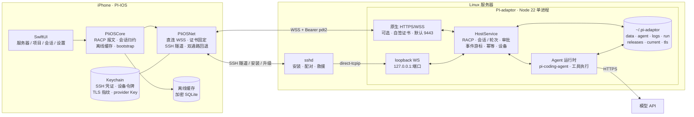
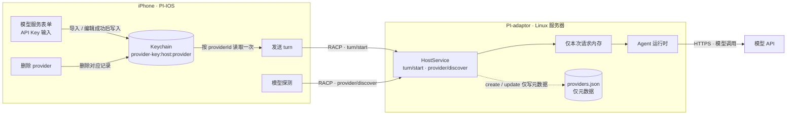

# PI-IOS

> **手机是遥控器，服务器是工作台。**

PI-IOS 是一个 iOS 原生客户端，用来遥控运行在自己 Linux 服务器上的 **PI-adaptor** Agent Host。

模型请求、工具执行与文件读写都发生在服务器侧；手机只负责「看」「批」「发消息」「配置」。
SSH 凭证、设备令牌、直连证书指纹和模型 API Key 只存本机 Keychain。
目标机器是一台空 Linux 服务器：添加 SSH 凭证后，安装、配对、升级都可以直接在手机上完成。

---

## 功能

### 服务器

- 多 Host 管理，随时切换当前服务器。
- SSH 密码或 OpenSSH 私钥认证；主机指纹首次信任（TOFU），指纹变化时拒绝建连并提示。
- 测试连接会真实登录一次服务器，失败原因原样显示。
- 可选直连：手工填写 `wss://` endpoint，首次确认并固定自签证书的 SHA-256 指纹；启用后日常使用不再建立 SSH。

### 安装与升级

- 从手机把 PI-adaptor 安装到空服务器：下载对应架构的发布包、校验 SHA-256、解包、原子切换 `current`。
- 自动生成并启动 `pi-adaptor.service`（systemd user unit），失败可重试或重新授权 sudo。
- 已安装版本、运行版本与期望版本不一致时给出明确提示。

### 项目与会话

- 浏览服务器目录、注册项目、创建/改名/归档/删除会话。
- 会话内运行 turn，流式查看回复、工具调用与结果。
- 审批卡（allow once / allow session / deny）、提问卡、中断与排队发送。
- 工具结果默认折叠，大结果按有界预览展示。

### 模型

- 从服务器发现可用模型，显示 context、最大输出与 effort 档位。
- 导入 / 删除 Host v2 provider，管理默认模型与模型参数。
- provider API Key 只存本机 Keychain，导入、发送与探测时随请求一次性传给 Host，服务端不落盘。

### 离线与本机

- 会话只读缓存，可配置每个会话的缓存条数；离线时明确标注并说明原因。
- 连接断开后按 1s/2s/4s/8s 退避重连（上限 30s）；直连优先时，只有传输故障才回退 SSH 一次，回退后保持 SSH 直到新的连接意图。
- 外观模式（跟随系统 / 浅色 / 深色）、Skill 管理、撤销本机配对。
- 不依赖后台推送：打开 App 时才刷新服务器状态与新消息。

## 架构



**客户端分层**

| 层 | 职责 |
|---|---|
| SwiftUI | 根页与导航、服务器 / 直连配置、项目与会话、会话流、审批与提问、模型 / Skill 设置 |
| `PIiOSNet` | 直连 WSS（TLS 指纹固定、设备令牌）、SSH 传输与 `direct-tcpip`、双通路选择与一次回退、重连退避、订阅游标、bootstrap 安装 |
| `PIiOSCore` | RACP 报文、会话与工具卡归约、加密 SQLite 离线缓存、bootstrap / 安装状态机、provider 与模型分组、通知策略 |

**Host**

PI-adaptor 是 Node 22 + TypeScript 的单进程 Host，基于 `@earendil-works/pi-coding-agent` 执行模型调用与工具。
进程内只有一套 `HostService`：RACP 方法、会话与轮次、审批门禁、事件游标、幂等、设备与权限。
对外有两个监听：

- 回环明文 WS：`127.0.0.1` 上的可配端口，只经 SSH `direct-tcpip` 访问；
- 可选原生 HTTPS/WSS（默认关闭）：使用显式配置的 host 与固定端口（默认 `9443`），自签证书，只接受有效 `pdt2` 设备令牌。

两条通路共享同一 `hostId`、设备库、事件与业务状态。数据、日志、release 与证书都在 `~/.pi-adaptor`。

**设计要点**

- **双通路，同一业务**：直连优先时日常流量走 WSS；只有传输故障才自动回退 SSH，且每个连接意图最多一次。回退后保持 SSH，新的连接意图或用户主动重试才重新评估直连。安装、配对、升级、端口探测与救援仍按需走 SSH。
- **直连信任不靠网站 CA**：服务端用 OpenSSL 生成单张自签叶证书；iOS 固定完整证书 DER 的 SHA-256，并校验有效期、SAN 与认证后取得的 `hostId`。证书或 pin 变化必须重新经可信 SSH 授权，不做热轮换。
- **协议是 RACP**：冻结契约为 `2.0.0`。生产客户端沿用 v1 握手并在其上增量使用 v2 方法；v2 握手代际保留给 `HostV2Client` 与测试，两者不混用。
- **密钥边界**：SSH 凭证、设备令牌、直连证书指纹与 provider API Key 只存 iOS Keychain；provider Key 随请求一次性传给 Host，校验或使用后即丢弃、不落盘；TLS 私钥只留在服务器（`0600`）。
- **断线可恢复**：重连按 1s/2s/4s/8s…30s 退避；按事件游标续传，游标失效则重建快照；离线退回加密 SQLite 缓存。

**模型 Key 流向**



正常流程下，模型 API Key 只存 iOS Keychain（`provider-key:<hostUUID>:<providerId>`，按服务器与 provider 隔离，
`ThisDeviceOnly`、不参与 iCloud 同步），不写入 `state-v1.json`；发送时按 `selectedProviderId` 读取一次，
作为 `turn/start.apiKey` 随 RACP 传给 Host。Host 的 `ProviderStore` 只保存 provider 元数据，
`create` / `update` 收到的 `apiKey` 校验后丢弃；旧版 `~/.pi-adaptor/data/providers/secrets/` 会在启动时清理。
模型探测 `provider/discover` 同样只在请求内携带临时 key。`providerSeedFile` 仅用于测试 / bootstrap，
会在服务器保留明文 key，生产不要启用。换设备时 Keychain 不会同步或迁移，需要在新设备上重新填写。

## 项目结构

| 路径 | 内容 |
|---|---|
| `apps/ios/` | SwiftUI 客户端 `PI-IOS` 与 `PIiOSKit` SPM 包（领域层 `PIiOSCore`、传输层 `PIiOSNet`） |
| `apps/pi-adaptor/` | **PI-adaptor**（git submodule）：Node 22 + TypeScript Host，独立仓库 [RuidongWang/PI-adaptor](https://github.com/RuidongWang/PI-adaptor) |
| `apps/pi-adaptor/host-release.json` | Host 发布坐标（版本、tag、各平台摘要），随 submodule commit 固定 |
| `server/` | 遗留 pi-host 打包脚本（存档，不参与 PI-adaptor 发布） |

**PI-adaptor 子模块**

```sh
# 首次克隆
git clone --recurse-submodules https://github.com/RuidongWang/PI-IOS.git
# 已有克隆或拉到新的 submodule 指针后
git submodule update --init --recursive
```

PI-IOS 只依赖 PI-adaptor 的接口契约与发布包布局：RACP 协议（`apps/pi-adaptor/docs/api/pi-adaptor.md`，
配 machine schema 与 golden）、direct / SSH 双通路增量契约的 schema 与 golden
（`apps/pi-adaptor/docs/api/direct-racp-ssh-fallback.*`）和发布包布局
（`apps/pi-adaptor/host-release.json` + `scripts/install.sh`）。子模块固定的 commit
同时决定 Host 版本与 App 的 `PIAdaptorRelease` 常量；升级 Host 时先在 PI-adaptor 仓库发版，
再更新本仓库的子模块指针。CI 与发布门禁（`scripts/check-host-release-consistency.py`）
要求子模块已初始化。

## 快速开始

**运行 App**

```sh
open apps/ios/PI-IOS.xcodeproj
```

选择 `PI-IOS` scheme 和 iOS 17+ 模拟器或真机运行。首次进入设置页，点「＋ 添加服务器」录入 SSH 凭证。

**本地起一个 PI-adaptor**

```sh
git submodule update --init apps/pi-adaptor
cd apps/pi-adaptor
pnpm install --ignore-scripts
pnpm start -- --pair        # 打印一次性配对令牌
```

默认数据都在 `~/.pi-adaptor`。配对令牌可直接在 App 的「添加服务器 → 配对」中使用。

**环境要求**

- iOS 客户端：macOS 14+、Xcode（含 iOS 17 SDK）。
- PI-adaptor：Node ≥ 22.19.0、`pnpm`。
- 服务器：可 SSH 的 Linux（x86_64 / arm64），能访问模型 API；启用直连时还需放行配置的 TLS 端口。

## 鸣谢

- <https://github.com/vastsa/PI-Desktop>
