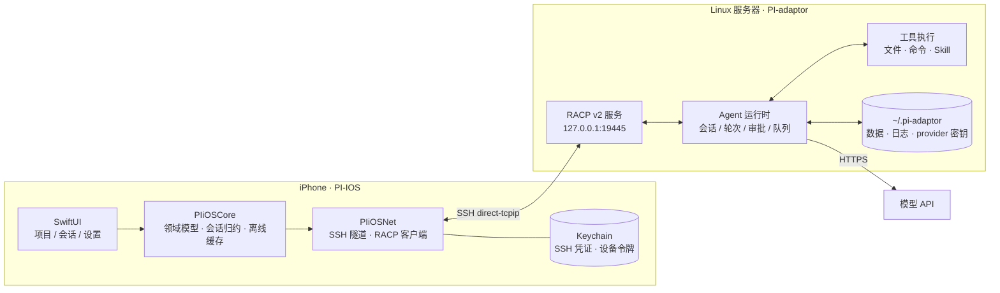

# PI-IOS

> **手机是遥控器，服务器是工作台。**

PI-IOS 是一个 iOS 原生客户端，用来遥控运行在自己 Linux 服务器上的 **PI-adaptor** Agent Host。

模型请求、工具执行、文件读写、密钥存储全部发生在服务器侧；手机只负责「看」「批」「发消息」「配置」。
目标机器是一台空 Linux 服务器：添加 SSH 凭证后，安装、配对、升级都可以直接在手机上完成。

---

## 功能

### 服务器

- 多 Host 管理，随时切换当前服务器。
- SSH 密码或 OpenSSH 私钥认证；主机指纹首次信任（TOFU），指纹变化时拒绝建连并提示。
- 测试连接会真实登录一次服务器，失败原因原样显示。

### 安装与升级

- 从手机把 PI-adaptor 安装到空服务器：下载对应架构的发布包、校验 SHA-256、解包、原子切换 `current`。
- 自动生成并启动 `pi-adaptor.service`（systemd user unit），失败可重试或重新授权 sudo。
- 已安装版本、运行版本与期望版本不一致时给出明确提示。

### 项目与会话

- 浏览服务器目录、注册项目、创建/改名/归档/删除会话。
- 会话内运行 turn，流式查看回复、工具调用与结果。
- 审批卡（allow once / allow session / deny）、提问卡、中断与排队发送。
- 工具结果默认折叠，大结果按有界预览展示。

### 模型

- 从服务器发现可用模型，显示 context、最大输出与 effort 档位。
- 导入 / 删除 Host v2 provider，管理默认模型与模型参数。

### 离线与本机

- 会话只读缓存，可配置每个会话的缓存条数；离线时明确标注并说明原因。
- 隧道断开后按 1s/2s/4s/8s 自动重连。
- 外观模式（跟随系统 / 浅色 / 深色）、Skill 管理、撤销本机配对。
- 不依赖后台推送：打开 App 时才刷新服务器状态与新消息。

## 架构



**客户端分层**

| 层 | 职责 |
|---|---|
| SwiftUI | 根页与导航、列表/表单、会话流、审批与提问交互 |
| `PIiOSNet` | SSH 隧道、RACP WebSocket 连接、断线重连、订阅游标 |
| `PIiOSCore` | RACP 报文、会话与工具卡归约、离线缓存策略、bootstrap 状态机 |

**Host**

PI-adaptor 负责会话与轮次调度、审批门禁、工具执行、provider 密钥管理和本地文件访问，
只监听回环地址，通过 SSH 隧道对客户端可见。

**设计要点**

- **网络边界是 SSH**：端口不暴露公网，客户端经 `direct-tcpip` 访问回环端口。
- **协议是 RACP v2**：沿用上游 PI-Desktop 冻结的协议，客户端实现其中的子集并跟进增量方法。
- **密钥两端隔离**：模型 API Key 只存在服务器侧；客户端凭证只存 iOS Keychain。
- **断线可恢复**：重连后按游标补齐事件，必要时重建快照；离线时退回只读缓存。

## 项目结构

| 路径 | 内容 |
|---|---|
| `apps/ios/` | SwiftUI 客户端 `PI-IOS` 与 `PIiOSKit` SPM 包（领域层 `PIiOSCore`、传输层 `PIiOSNet`） |
| `apps/pi-adaptor/` | **PI-adaptor**（git submodule）：Node 22 + TypeScript Host，独立仓库 [RuidongWang/PI-adaptor](https://github.com/RuidongWang/PI-adaptor) |
| `apps/pi-adaptor/host-release.json` | Host 发布坐标（版本、tag、各平台摘要），随 submodule commit 固定 |
| `server/` | 遗留 pi-host 打包脚本（存档，不参与 PI-adaptor 发布） |

**PI-adaptor 子模块**

```sh
# 首次克隆
git clone --recurse-submodules https://github.com/RuidongWang/PI-IOS.git
# 已有克隆或拉到新的 submodule 指针后
git submodule update --init --recursive
```

PI-IOS 只依赖 PI-adaptor 的两处契约：RACP v2 协议（`apps/pi-adaptor/docs/api/pi-adaptor.md`）
和发布包布局（`apps/pi-adaptor/host-release.json` + `scripts/install.sh`）。子模块固定的 commit
同时决定 Host 版本与 App 的 `PiHostRelease` 常量；升级 Host 时先在 PI-adaptor 仓库发版，
再更新本仓库的子模块指针。CI 与发布门禁（`scripts/check-host-release-consistency.py`）
要求子模块已初始化。

## 快速开始

**运行 App**

```sh
open apps/ios/PI-IOS.xcodeproj
```

选择 `PI-IOS` scheme 和 iOS 17+ 模拟器或真机运行。首次进入设置页，点「＋ 添加服务器」录入 SSH 凭证。

**本地起一个 PI-adaptor**

```sh
git submodule update --init apps/pi-adaptor
cd apps/pi-adaptor
pnpm install --ignore-scripts
pnpm start -- --pair        # 打印一次性配对令牌
```

默认数据都在 `~/.pi-adaptor`。配对令牌可直接在 App 的「添加服务器 → 配对」中使用。

**环境要求**

- iOS 客户端：macOS 14+、Xcode（含 iOS 17 SDK）。
- PI-adaptor：Node ≥ 22.19.0、`pnpm`。
- 服务器：可 SSH 的 Linux（x86_64 / arm64），能访问模型 API。

## 鸣谢

- <https://github.com/vastsa/PI-Desktop>
