<p align="center">
  
</p>

# PI-IOS

> **手机是遥控器，服务器是工作台。**

PI-IOS 是一个 iOS 原生客户端（iOS 17+，当前版本 `0.0.9`），用来遥控运行在自己 Linux 服务器上的 **PI-adaptor** Agent Host。

模型请求、工具执行与文件读写都发生在服务器侧；手机只负责「看」「批」「发消息」「配置」。
SSH 凭证、主机指纹、设备令牌、直连证书指纹、模型 API Key 与离线缓存密钥只存本机 Keychain（`ThisDeviceOnly`，不参与 iCloud 同步）。
目标机器是一台空 Linux 服务器：添加 SSH 凭证后，安装、配对、升级都可以直接在手机上完成。

---

## 功能

### 服务器与连接

- 多 Host 管理与侧边栏快速切换，设置页提供高级诊断（`systemd` 服务状态、最近错误、运行版本一致性检查）及当前服务返回的 Pi 版本展示。
- SSH 密码或 OpenSSH 私钥认证（支持 `ssh-ed25519`、`ecdsa-sha2-nistp256/384/521`、`ssh-rsa` 及带口令私钥），支持通过系统「文件」选择器或直接粘贴导入；主机指纹首次信任（TOFU），指纹变化时拒绝建连并弹窗核对。
- 「保存并测试连接」会真实登录一次服务器，失败原因原样显示；支持使用一次性 `ppt2.` 令牌配对，令牌失效或设备被撤销时提供就地重新配对入口。
- 可选直连：手工填写 `wss://.../v1/racp/ws` endpoint，经可信 SSH 确认并固定自签证书 SHA-256 指纹与 `hostId`；启用直连优先后日常使用不再建立 SSH。

### 安装与升级

- 从手机把 PI-adaptor 安装到空服务器：按服务端 `uname -m` 选择 `linux-x64` / `linux-arm64` 发布包、校验 SHA-256、解包并原子切换 `~/.pi-adaptor/current`。
- 引导安装选择与当前 PI-IOS 兼容的最新稳定版。PI-adaptor 发布说明可用独立一行 `<!-- pi-ios-min-version: 0.0.9 -->` 声明最低 App 版本。没有声明时，最低 App 版本与 Host 版本相同。无法拉取线上发布清单时，回退到客户端内嵌摘要校验的 `0.0.9` 版本。
- 安装时可一并配置直连参数；自动生成并启动 `pi-adaptor.service`（systemd user unit），服务器端使用 `setsid`、`nohup` 与 `flock`。支持失败重试、重新授权 sudo、强制重装以及查看 `.bootstrap` 安装日志。
- 安装前检查磁盘版本和 systemd 服务的运行版本（通过当前服务实例的启动日志核实，无法确认版本时会提示并暂停安装）。

### 项目与会话

- 浏览服务器目录、注册 / 归档 / 恢复项目；侧边栏支持会话搜索、置顶与拖拽排序、归档及删除。
- 新建会话后由 AI 根据首条指令自动生成标题，也支持手动重命名。
- 会话内流式运行 turn，支持 Markdown 富文本渲染、图片附件（从相册选择最多 10 张 JPEG / PNG / WebP）、排队发送与取消、运行中中断。
- 会话与权限选项按 Host 握手声明展示。当前 Host 支持 `agent`、`ask` / `auto`；不支持 Plan 执行，历史 Plan 会话须先切回 Agent。模型与思考档位可独立切换。
- 固定在滚动区上方的审批卡片：工具权限审批（允许一次 / 本会话允许 / 拒绝，超大参数可分片读取审阅完整参数后再放行）与 Plan / Goal 契约审批（批准 / 驳回）。
- 工具调用按轮次折叠，大结果按有界预览展示；支持长历史分页加载、阅读位置记忆与完整正文复制。

### 模型服务

- 支持 4 种线路协议预设：`OpenAI Chat Completions`（`openai-completions`）、`OpenAI Responses`（`openai-responses`）、`Anthropic Messages`（`anthropic-messages`）、`Google Generative AI`（`google-generative-ai`），默认预填本机网关 `http://localhost:8080`。
- 从服务器探测可用模型，显示并可编辑 context、最大输出与思考档位；支持导入 / 删除 Host v2 provider 与管理默认模型。
- provider API Key 只存本机 Keychain，导入、发送与探测时随请求一次性传给 Host，服务端不落盘。

### 能力与扩展

- **全局 Skill**：查看 PI-adaptor 已安装的全局 Skill，支持从 Git 或本地路径安装，以及删除服务端安装副本。
- **扩展（Extensions）**：查看服务端用户扩展配置清单（加载开关、入口文件状态与 headless 兼容性）以及单次会话的扩展运行时加载结果与失败详情。

### 离线、通知、日志与本机

- **加密离线缓存**：使用 AES-GCM 逐列加密会话正文、草稿、审批参数与标题后写入本机 SQLite（密钥存 Keychain）；可在设置中配置每会话缓存上限（100 / 200 / 500 / 1000 轮），离线时明确标注只读状态。
- **断线恢复**：重连期间保留当前实时会话视图；连接断开后按 1s/2s/4s/8s 退避重连（上限 30s）。直连优先时，仅传输故障会自动回退 SSH 一次，回退后保持 SSH 直到新的连接意图或手动重试直连。
- **本地运行日志**：支持开启 / 关闭日志、切换日志等级与时间格式、合并预览磁盘与内存日志、导出分享及清空本机记录。
- **更新提醒与本机设置**：App 回到前台发现离开期间有会话更新或新增审批时可触发本地通知（不依赖后台推送，默认不主动弹窗索取权限，由用户在设置页按需启用）；支持外观模式（跟随系统 / 浅色 / 深色）与撤销本机配对。

---

## 架构

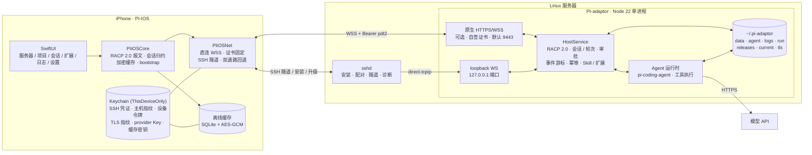

### 客户端分层

| 层 | 职责 |
|---|---|
| `PI-IOS`（SwiftUI） | 根页与抽屉导航、服务器 / 直连 / 安装配置、项目与会话流、审批与媒体附件、模型 / Skill / 扩展 / 日志与本机设置 |
| `PIiOSNet` | 直连 WSS（TLS 指纹固定、`Bearer` 设备令牌）、SSH 传输与 `direct-tcpip`（基于本地 vendored `swift-nio-ssh`，补充 RSA 密钥支持）、双通路选择与一次回退、重连退避、bootstrap 安装 |
| `PIiOSCore` | RACP 2.0 报文、会话与工具卡归约、AES-GCM + SQLite 离线缓存、bootstrap 状态机、provider 与模型分组、日志与本地通知策略 |

### Host

PI-adaptor（`0.0.9`）是 Node 22 + TypeScript 的单进程 Host，基于 `@earendil-works/pi-coding-agent@1.6.0` 执行模型调用与工具。
进程内只有一套 `HostService`：RACP 2.0 方法、会话与轮次、审批门禁、事件游标、幂等、媒体附件、Skill 与扩展目录、设备与权限。
对外有两个监听：

- 回环明文 WS：`127.0.0.1` 上的可配端口，只经 SSH `direct-tcpip` 访问；
- 可选原生 HTTPS/WSS（默认关闭）：使用显式配置的 host 与固定端口（默认 `9443`），自签证书，只接受有效 `pdt2.` 设备令牌。

两条通路共享同一 `hostId`、设备库、事件与业务状态。数据、日志、release 与证书都在 `~/.pi-adaptor`，与旧版 `~/.pi-desktop` 完全隔离。

### 设计要点

- **双通路，同一业务**：直连优先时日常流量走 WSS；只有传输故障才自动回退 SSH，且每个连接意图最多一次。回退后保持 SSH，新的连接意图或用户主动重试才重新评估直连。安装、配对、升级、端口探测与服务状态检查仍按需走 SSH。
- **直连信任不靠网站 CA**：服务端用 OpenSSL 生成单张自签叶证书；iOS 固定完整证书 DER 的 SHA-256，并校验有效期、SAN 与认证后取得的 `hostId`。证书或 pin 变化必须重新经可信 SSH 授权，不做热轮换。
- **协议是 RACP 2.0.0**：路径 `/v1/racp/ws`，WebSocket 子协议统一为 `pi-racp.v2.jsonrpc`，单条控制帧上限 1 MiB。除 `connection/initialize` 与 `connection/pair` 外，所有请求均需携带有效 `pdt2.` 设备令牌。
- **密钥边界**：SSH 凭证、主机指纹、设备令牌、直连证书指纹、provider API Key 与离线缓存加密密钥只存 iOS Keychain；provider Key 随请求一次性传给 Host，校验或使用后即丢弃、不落盘；TLS 私钥只留在服务器（`0600`）。
- **断线可恢复**：重连按 1s/2s/4s/8s…30s 退避；按持久事件游标续传，游标失效则重建快照；离线退回加密 SQLite 缓存。

### 模型 Key 流向

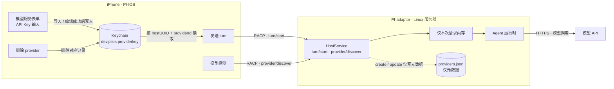

正常流程下，模型 API Key 只存 iOS Keychain（`dev.piios.providerkey` 服务下按服务器与 provider 隔离，`ThisDeviceOnly`、不参与 iCloud 同步），不写入 `state-v1.json`；发送时按 `selectedProviderId` 读取一次，作为 `turn/start.apiKey` 随 RACP 传给 Host。Host 的 `ProviderStore` 只保存 provider 元数据，`create` / `update` 收到的 `apiKey` 校验后丢弃；旧版 `~/.pi-adaptor/data/providers/secrets/` 会在启动时清理。模型探测 `provider/discover` 同样只在请求内携带临时 key。`providerSeedFile` 仅用于测试 / bootstrap，会在服务器保留明文 key，生产不要启用。换设备时 Keychain 不会同步或迁移，需要在新设备上重新填写。

---

## 项目结构

| 路径 | 内容 |
|---|---|
| `apps/ios/PI-IOS/` | SwiftUI 客户端主工程（视图、状态管理、Keychain、离线缓存适配、日志与通知） |
| `apps/ios/PIiOSKit/` | Swift Package：领域层 `PIiOSCore`、传输层 `PIiOSNet` 与本地 vendored `Vendor/swift-nio-ssh` |
| `apps/ios/PI-IOSTests/` | iOS App 单元测试 |
| `apps/ios/PI-IOSUITests/` | 离线夹具 UI 回归套件与视觉验收截图夹具（`VisualReviewUITests`） |
| `apps/ios/scripts/` | 未签名 IPA 打包脚本（`build-unsigned-ipa.sh`）等 |
| `apps/pi-adaptor/` | **PI-adaptor**（git submodule）：Node 22 + TypeScript Host，独立仓库 [RuidongWang/PI-adaptor](https://github.com/RuidongWang/PI-adaptor) |
| `apps/pi-adaptor/host-release.json` | Host 发布坐标（版本、tag、各平台摘要），随 submodule commit 固定 |
| `scripts/` | 串行构建（`pi-build.sh`）、测试（`pi-test.sh`）、全量验证（`pi-verify-all.sh`）、版本一致性门禁（`check-host-release-consistency.py`）与密钥扫描（`check-secrets.sh`） |
| `assets/` | App Logo 与演示截图（`assets/demo/`） |
| `server/` | 遗留 `pi-host` 打包脚本（存档，不参与 PI-adaptor 发布） |

### PI-adaptor 子模块

```sh
# 首次克隆
git clone --recurse-submodules https://github.com/RuidongWang/PI-IOS.git
# 已有克隆或拉到新的 submodule 指针后
git submodule update --init --recursive
```

PI-IOS 只依赖 PI-adaptor 的接口契约与发布包布局：RACP 2.0 协议（`apps/pi-adaptor/docs/api/pi-adaptor.md`，配 machine schema 与 golden）、direct / SSH 双通路增量契约（`apps/pi-adaptor/docs/api/direct-racp-ssh-fallback.*`）和发布包布局（`apps/pi-adaptor/host-release.json` + `apps/pi-adaptor/scripts/install.sh`）。子模块固定的 commit 同时决定 Host 版本与 App 的 `PIAdaptorRelease` 常量；升级 Host 时先在 PI-adaptor 仓库发版，再更新本仓库的子模块指针。CI 与发布门禁（`scripts/check-host-release-consistency.py`）要求子模块已初始化。

---

## 快速开始

### 运行 App

```sh
open apps/ios/PI-IOS.xcodeproj
```

选择 `PI-IOS` scheme 和 iOS 17+ 模拟器或真机运行。首次进入设置页，点「添加服务器」录入 SSH 凭证。

### 本地起一个 PI-adaptor

```sh
git submodule update --init apps/pi-adaptor
cd apps/pi-adaptor
pnpm install --ignore-scripts
pnpm start -- --pair        # 打印一次性配对令牌（ppt2.…）
```

默认数据都在 `~/.pi-adaptor`。配对令牌可直接在 App 的「服务器 → 一次性配对令牌」中使用。

### 环境要求

- **iOS 客户端**：macOS 14+、Xcode（含 iOS 17+ SDK）。
- **PI-adaptor**：Node ≥ 22.19.0、`pnpm`。
- **服务器**：可 SSH 的 Linux（`x86_64` / `arm64`），能访问模型 API；启用直连时还需放行配置的 TLS 端口（默认 `9443`）。

---

## 构建与测试

```sh
# Host 类型检查与单元测试
pnpm --dir apps/pi-adaptor typecheck
pnpm --dir apps/pi-adaptor test

# iOS SPM 领域与传输层测试（PIiOSCoreTests + PIiOSNetTests）
DEVELOPER_DIR=/Applications/Xcode.app/Contents/Developer \
  swift test --package-path apps/ios/PIiOSKit

# 串行增量编译 / App 单测 / 离线 UI 回归（共享 DerivedData 锁）
bash scripts/pi-build.sh
bash scripts/pi-test.sh PI-IOSTests
bash scripts/pi-test.sh PI-IOSUITests

# 全量离线验证（L1 + L2 + L2b + L3）
bash scripts/pi-verify-all.sh

# 构建未签名 Release IPA（输出至 apps/ios/build/ipa/PI-IOS.ipa）
zsh apps/ios/scripts/build-unsigned-ipa.sh

# 发布一致性校验与敏感信息扫描
python3 scripts/check-host-release-consistency.py
bash scripts/check-secrets.sh
```

---

## 使用 Demo

以下截图来自 App 的视觉验收夹具，页面中的服务器、项目、模型和会话均为演示数据。

### 连接与设置

| 添加服务器 | 安装 PI-adaptor |
|---|---|
| 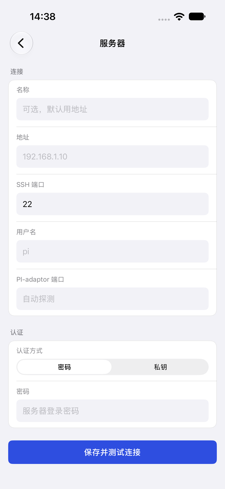 | 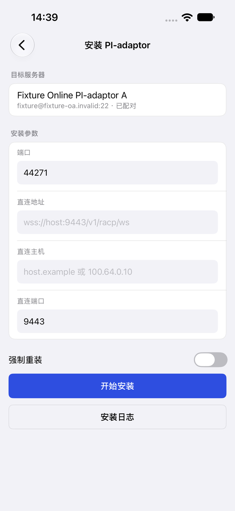 |

| 切换 Host | 设置 |
|---|---|
| 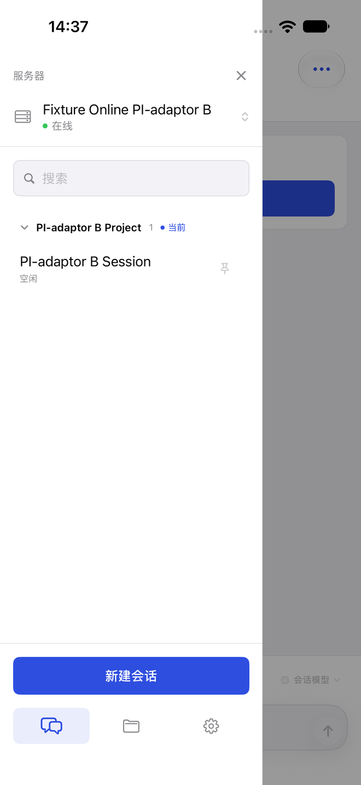 | 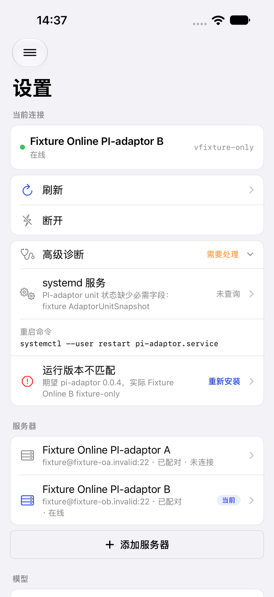 |

### 项目与会话交互

| 项目与会话 | 项目详情 |
|---|---|
| 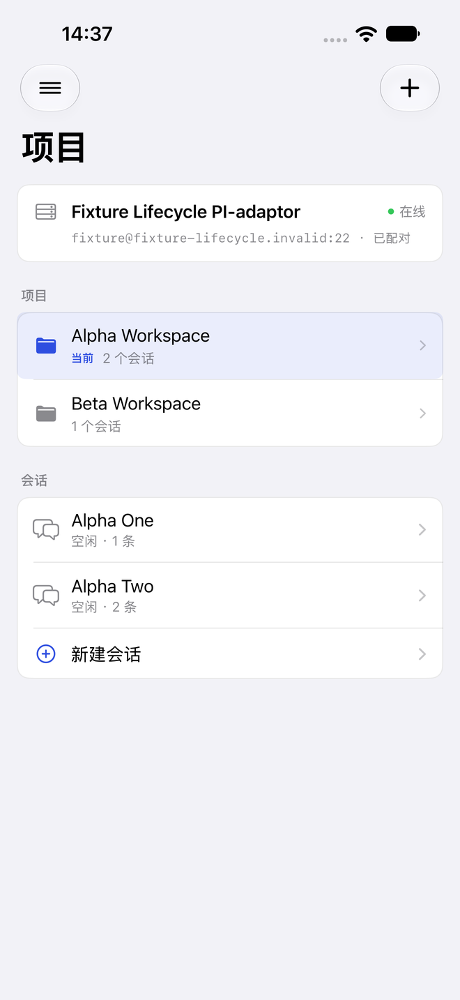 | 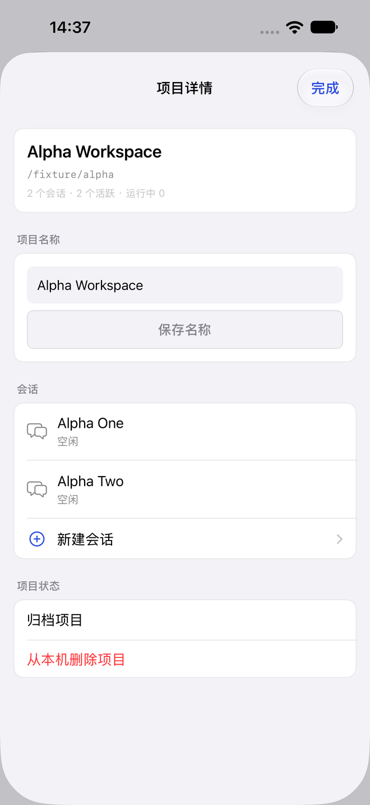 |

| Markdown 回复 | 工具调用展开 |
|---|---|
| 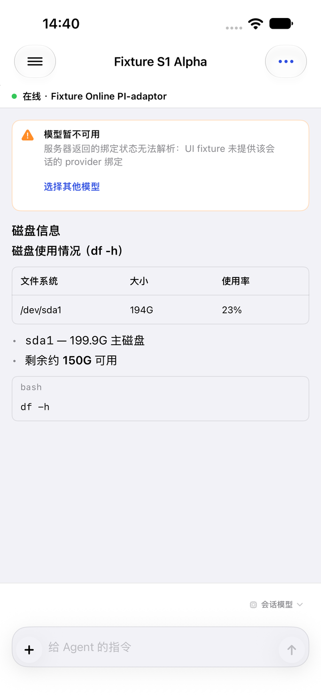 | 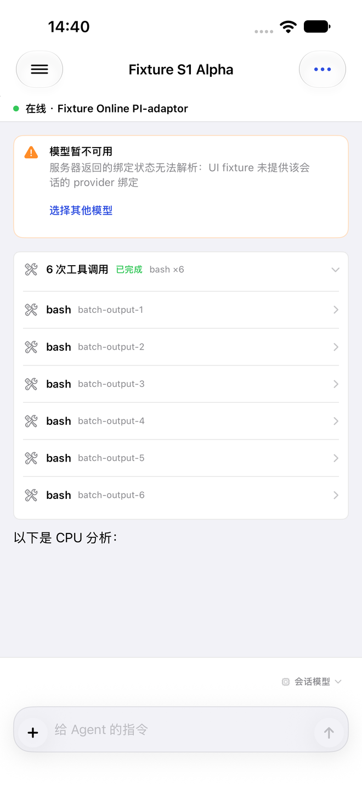 |

### 审批、模型与 Skill

| 审批工具调用 | 全局 Skill |
|---|---|
| 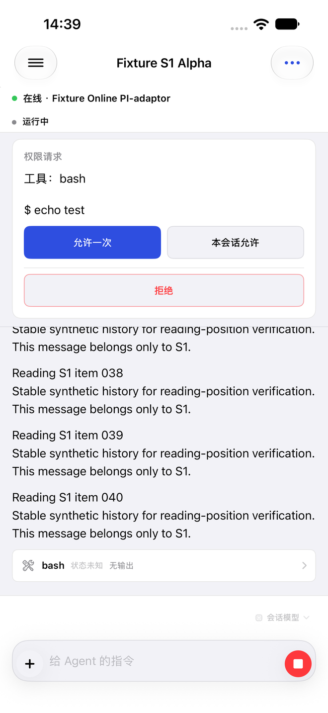 | 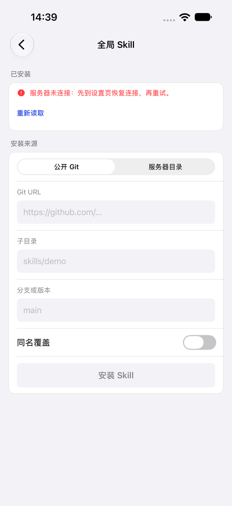 |

| 模型服务 | 模型服务详情 |
|---|---|
| 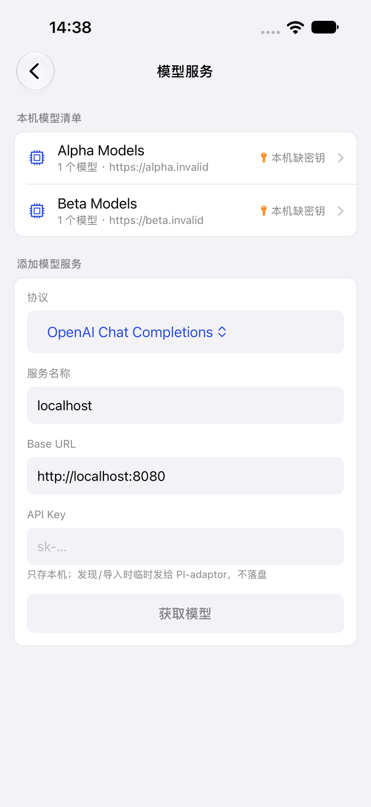 | 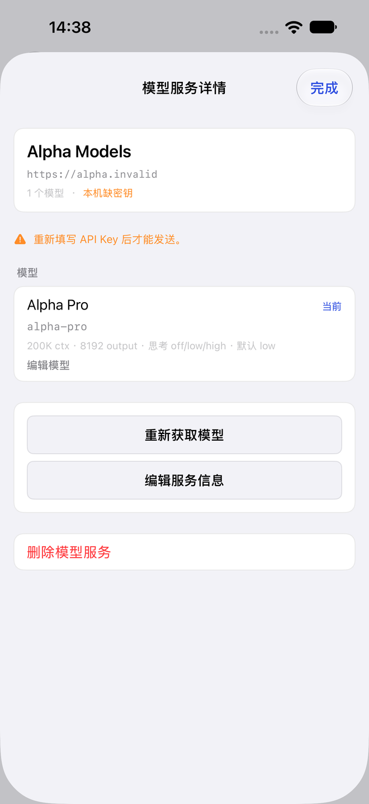 |

---

## 鸣谢

- <https://github.com/vastsa/PI-Desktop>
